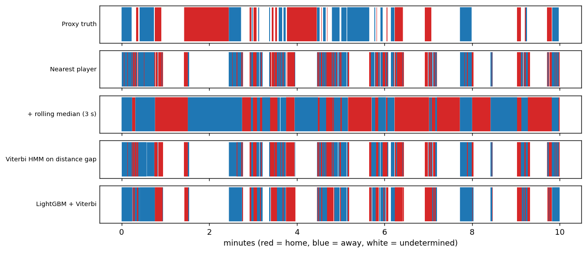

# Football Possession Estimator

Estimates which team has possession in **every frame** of a football match from
player and ball tracking data, and compares rule-based, smoothed and learned approaches.



## Why this project
Built while preparing for More Than a Hack 2027, whose Initial Challenge is to
estimate team possession per frame from automatic tracking data.

## Data
Metrica Sports public sample data (Sample Games 1 and 2, 25 Hz tracking + events):
https://github.com/metrica-sports/sample-data. It is **not** included in this repo.

## Approach
1. **Nearest player:** possession = team of the player closest to the ball.
2. **Threshold + hold:** only change possession when a player is within 3 m, else keep the last team.
3. **Temporal smoothing:** 3-second rolling median, and a 2-state Viterbi HMM driven by the
   distance gap between the nearest home and away player.
4. **LightGBM:** frame features (nearest and 2nd-nearest distances, distance gap, ball speed,
   players within 5 m, closing velocities, rolling context). Trained on one game, tested on the
   other (match-level split), then smoothed with Viterbi.

## Results
| Method | Game 1 acc | Game 2 acc | Game 1 flips | Game 2 flips |
|---|---|---|---|---|
| Nearest player | 0.862 | 0.866 | 1933 | 2072 |
| + 3 m threshold, hold last | 0.797 | 0.767 | 1318 | 1396 |
| + rolling median (3 s) | 0.835 | 0.815 | 378 | 358 |
| Viterbi HMM on distance gap | 0.887 | 0.894 | 953 | 952 |
| LightGBM (trained on the other game) | 0.958 | 0.966 | 1289 | 988 |
| LightGBM + Viterbi | 0.964 | 0.971 | 407 | 327 |

Labelled frames: game 1 = 78,386, game 2 = 80,655. 'Flips' = number of possession changes predicted (fewer = less flicker).

## Important caveat: the labels are a proxy
The sample data has no possession label, so labels are derived from the event data
(`src/possession/labels.py`): passes, shots, recoveries and set pieces start possession for that
team; ball-lost, ball-out, challenges and fouls make it undetermined and those frames are excluded.
Event labels are themselves approximate, and the learned model benefits from features that
correlate with how events are recorded. Treat these numbers as a development signal,
not as the score you would get on the official challenge data.

## What the results suggest
- The plain nearest-player rule is a strong baseline (about 86 percent).
- Holding the last team beyond a 3 m threshold made accuracy **worse** here, probably because
  possession often changes while the ball is loose or in flight.
- The rolling median cuts flicker a lot (about 1,900 flips down to about 380) but costs accuracy
  because it also smooths over genuine quick turnovers.
- Learned features plus HMM smoothing gave the best accuracy and far less flicker.

## Where to improve next
- Better labels (manual review of ambiguous segments, or use official definitions).
- Model ball height / in-flight passes; add pass-direction and receiver features.
- Sequence models; per-frame confidence; handle dead-ball periods explicitly.
- Evaluate on Sample Game 3 (EPTS format) and with cross-validation by period.

## Project structure
```
├── README.md
├── requirements.txt
├── run_experiments.py      # reproduces the results table and figures
├── src/possession/
│   ├── data.py             # load Metrica tracking + events
│   ├── labels.py           # proxy possession labels from events
│   ├── baseline.py         # nearest-player rules
│   ├── smoothing.py        # rolling median, Viterbi HMM
│   └── features.py         # features for LightGBM
├── tests/                  # pytest unit tests
├── docs/                   # figures and results.md
└── data/                   # git-ignored
```

## How to run
```
git clone https://github.com/metrica-sports/sample-data
pip install -r requirements.txt
python run_experiments.py --data-dir sample-data/data
python -m pytest
```

## License
MIT
